<div align="center">

<h1>Job Analyzer & ATS Resume Optimization Suite</h1>


<p><strong>Applicant Tracking System (ATS) Analysis Engine and Document Generation Platform</strong></p>

<p>
  <a href="https://skillicons.dev"></a>
</p>

<p>
  <a href="#overview">Overview</a> &bull;
  <a href="#system-architecture">Architecture</a> &bull;
  <a href="#visual-showcase-gallery">Visual Gallery</a> &bull;
  <a href="#core-capabilities">Capabilities</a> &bull;
  <a href="#installation--setup">Installation</a> &bull;
  <a href="#author--contact-information">Author</a>
</p>

</div>

---
## Overview

Job Analyzer is a full-stack recruitment intelligence platform designed to parse candidate resumes, extract key technical competencies, compare qualification profiles against job descriptions, and generate quantitative ATS match scores. The platform includes an automated cover letter synthesis module and multi-template PDF compilation engine.

---

## Visual Showcase Gallery

### Application Interface & ATS Scoring
<table width="100%" align="center">
  <tr>
    <td width="50%" align="center"><b>Candidate Dashboard & Document Manager</b><br><sub>Centralized management of resumes, candidate profiles, and target roles.</sub></td>
    <td width="50%" align="center"><b>Job Description Analysis</b><br><sub>Automated extraction of technical requirements and competencies.</sub></td>
  </tr>
  <tr>
    <td align="center"></td>
    <td align="center">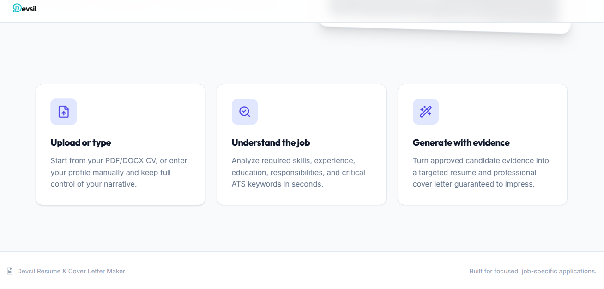</td>
  </tr>
  <tr>
    <td width="50%" align="center"><b>Resume Upload & Entity Extraction</b><br><sub>Ingestion of PDF/DOCX files with structured field parsing.</sub></td>
    <td width="50%" align="center"><b>Quantitative ATS Match Analytics</b><br><sub>Quantitative matching evaluation highlighting qualification alignment.</sub></td>
  </tr>
  <tr>
    <td align="center">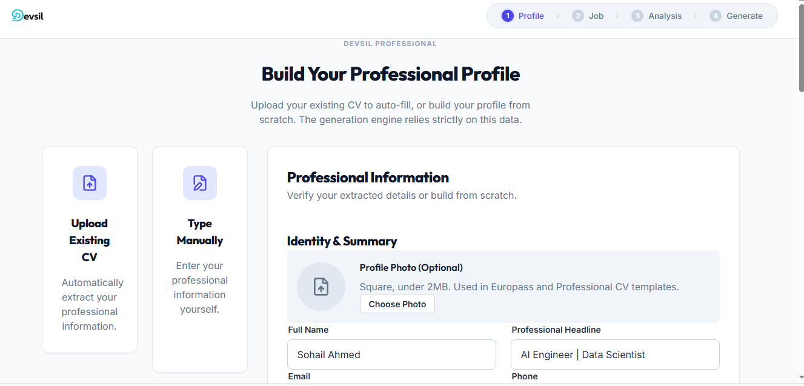</td>
    <td align="center"></td>
  </tr>
  <tr>
    <td width="50%" align="center"><b>Candidate Profile Editor</b><br><sub>Fine-tuning extracted work history and education records.</sub></td>
    <td width="50%" align="center"><b>Targeted Cover Letter Generation Studio</b><br><sub>Automated composition emphasizing relevant professional experience.</sub></td>
  </tr>
  <tr>
    <td align="center">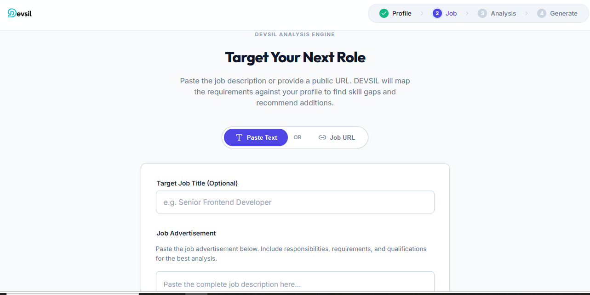</td>
    <td align="center">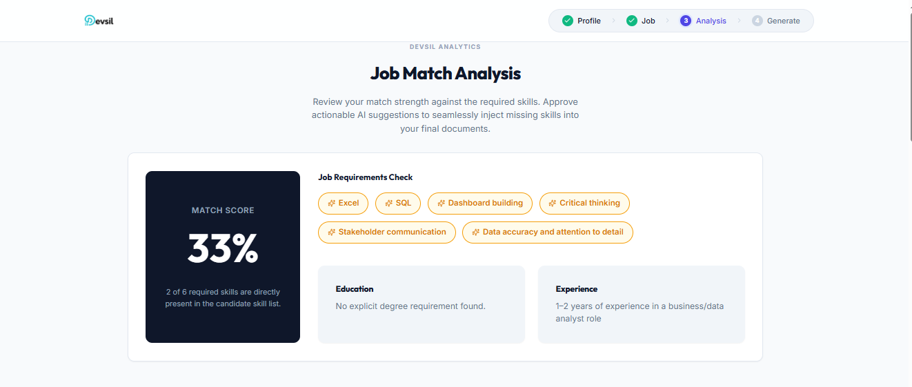</td>
  </tr>
  <tr>
    <td width="50%" align="center"><b>Document Template Selector</b><br><sub>Selection between ATS-Friendly, Europass, and Modern styles.</sub></td>
    <td width="50%" align="center"><b>Cover Letter Style Customizer</b><br><sub>Tone parametrization across corporate, executive, and creative formats.</sub></td>
  </tr>
  <tr>
    <td align="center">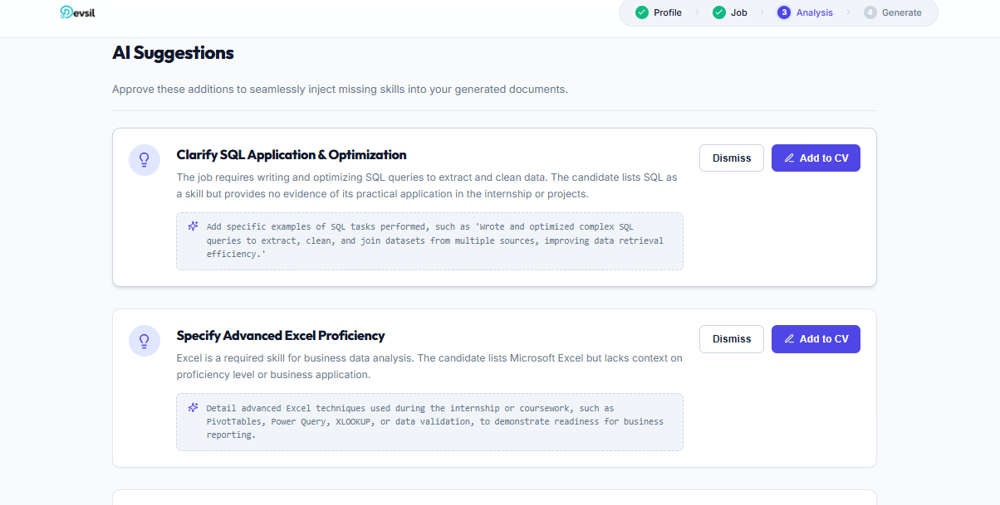</td>
    <td align="center">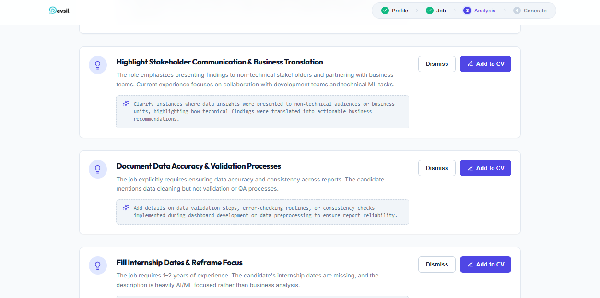</td>
  </tr>
  <tr>
    <td width="50%" align="center"><b>Interactive Live Document Preview</b><br><sub>Instant visual rendering of formatted resume and letter pages.</sub></td>
    <td width="50%" align="center"><b>Skill Gap Breakdown & Recommendations</b><br><sub>Detailed skill audit isolating missing technical competencies.</sub></td>
  </tr>
  <tr>
    <td align="center">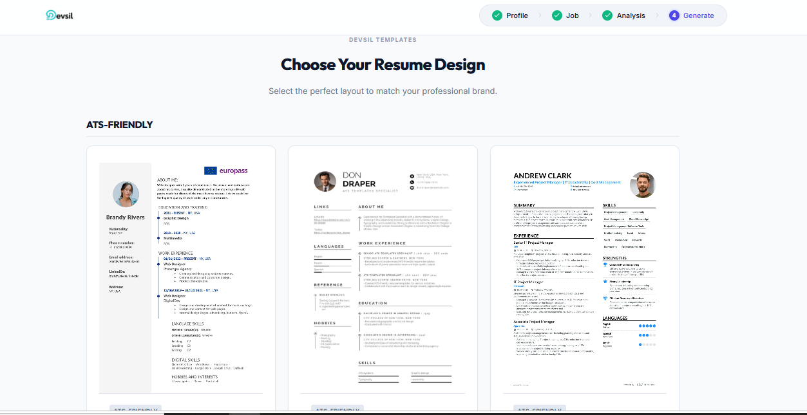</td>
    <td align="center">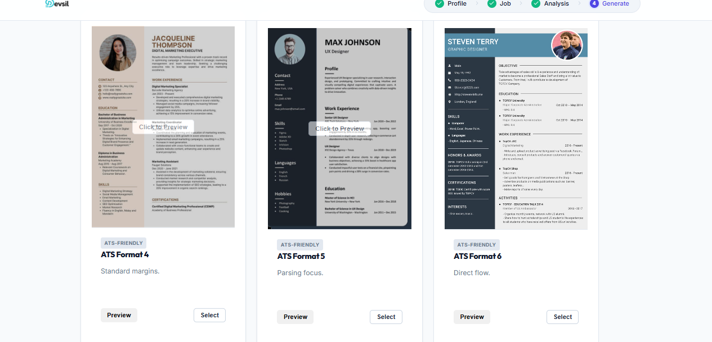</td>
  </tr>
  <tr>
    <td width="50%" align="center"><b>Keyword Optimization Suggestions</b><br><sub>Targeted semantic recommendations for boosting ATS scores.</sub></td>
    <td width="50%" align="center"><b>Multi-Role Tracking Matrix</b><br><sub>Comparative overview of candidate scores across target applications.</sub></td>
  </tr>
  <tr>
    <td align="center">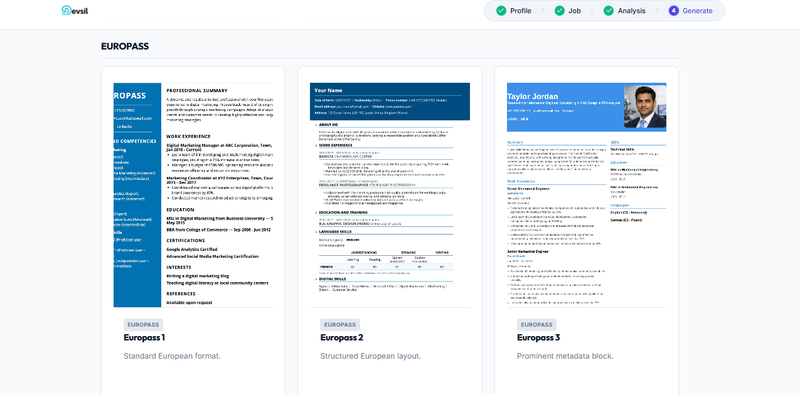</td>
    <td align="center">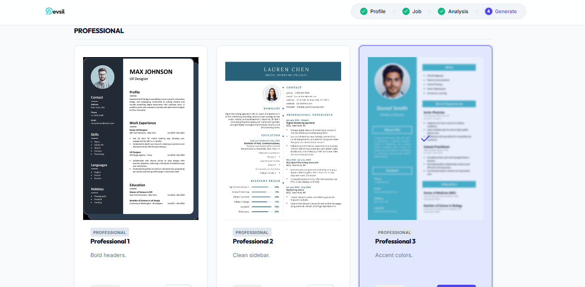</td>
  </tr>
  <tr>
    <td width="50%" align="center"><b>Candidate Experience Timeline</b><br><sub>Chronological work history mapping and duty alignment.</sub></td>
    <td width="50%" align="center"><b>Headless PDF Export Pipeline</b><br><sub>Playwright rendering compiling pixel-perfect PDF documents.</sub></td>
  </tr>
  <tr>
    <td align="center">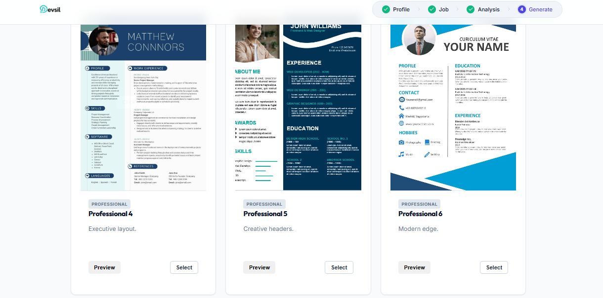</td>
    <td align="center">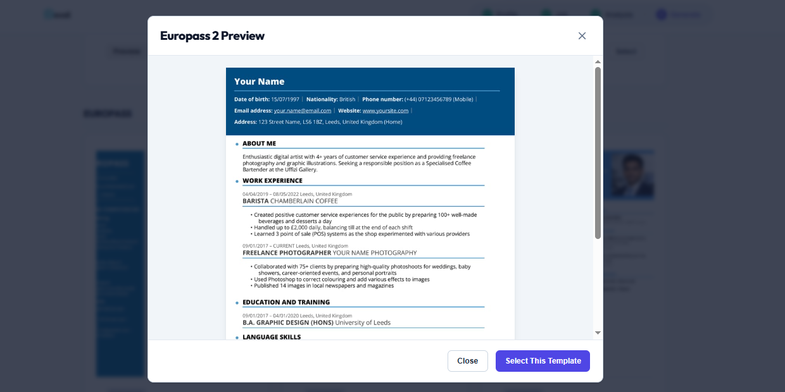</td>
  </tr>
  <tr>
    <td width="50%" align="center"><b>Export Format Selection</b><br><sub>Options for PDF, DOCX, and raw structured JSON export.</sub></td>
    <td width="50%" align="center"><b>Batch Job Application Management</b><br><sub>Lifecycle tracking from initial drafting to interview scheduling.</sub></td>
  </tr>
  <tr>
    <td align="center">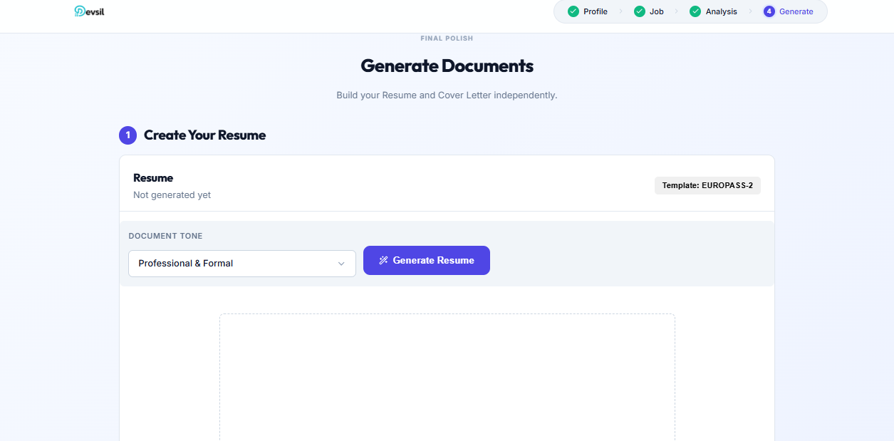</td>
    <td align="center">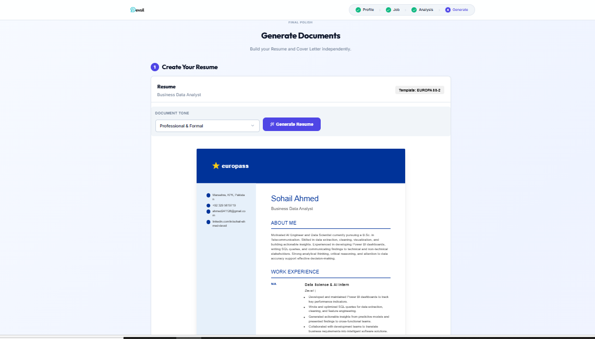</td>
  </tr>
  <tr>
    <td colspan="2" align="center"><b>Final Executive Document Review</b><br><sub>Full-screen verification before final client dispatch.</sub></td>
  </tr>
  <tr>
    <td colspan="2" align="center">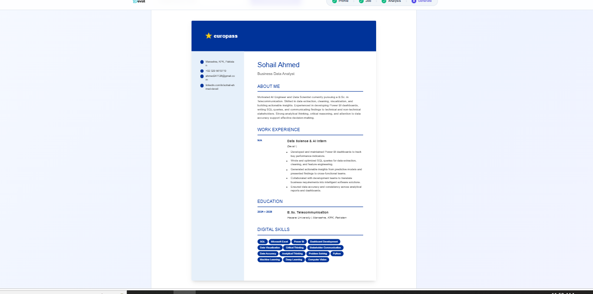</td>
  </tr>
</table>

---

## System Architecture

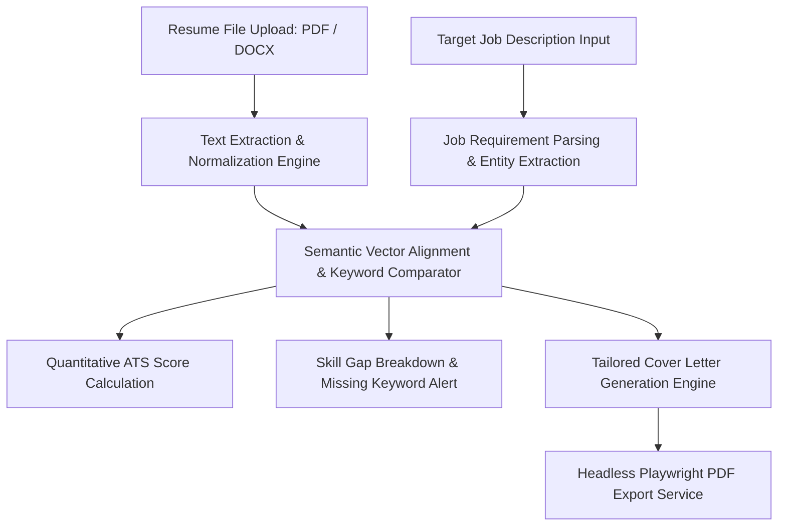

---

## Core Capabilities

- **Multi-Format Parsing Engine**: Parses unstructured text, work history, and educational credentials from PDF and DOCX files.
- **ATS Match Scoring Algorithm**: Evaluates candidate skill sets against job posting requirements using weighted keyword frequency and semantic context.
- **Automated Document Synthesis**: Formulates tailored, professional cover letters aligned to target role requirements.
- **Headless PDF Compilation**: Playwright-driven rendering service generating formatted, ATS-compliant documents.

---

## Technology Stack

| Layer | Technologies |
| :--- | :--- |
| Frontend | React 18, Vite, Tailwind CSS, Lucide Icons |
| Backend Server | Node.js, Express, RESTful APIs |
| Database & ORM | SQLite, Prisma ORM |
| Document Rendering | Playwright Headless Browser Service |
| AI Integration | LLM API Clients for Text Processing |

---

## Installation & Setup

```bash
# Clone the repository
git clone https://github.com/sohailahmed-bsrh/job-analyzer.git
cd job-analyzer

# Install dependencies
npm run install:all

# Run database migrations
npm run prisma:migrate

# Start application
npm run dev
```
---

## Author & Contact Information

<table width="100%" align="center">
  <tr>
    <td align="center" style="padding: 20px;">
      <h3>Sohail Ahmed</h3>
      <p><strong>Full-Stack Artificial Intelligence & Computer Vision Engineer</strong></p>
      <p>
        <a href="https://sohail.devsil.com"></a>
        <a href="https://github.com/sohailahmed-bsrh"></a>
        <a href="https://linkedin.com/in/sohail-ahmed-dev"></a>
        <a href="mailto:sohail.bsrh@gmail.com"></a>
      </p>
      <p><em>Available for technical roles in Artificial Intelligence, Computer Vision, and Full-Stack Engineering.</em></p>
      <hr style="border: 0; height: 1px; background: #30363d; margin: 15px 0;">
      <small>Repository: <code>sohailahmed-bsrh/job-analyzer</code> &bull; Distributed under the MIT License.</small>
    </td>
  </tr>
</table>
