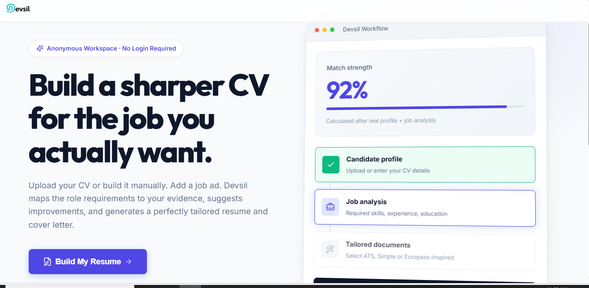
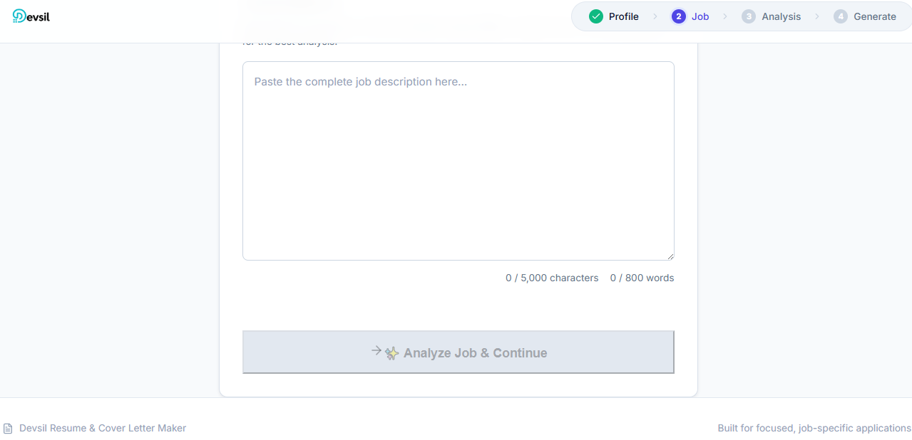
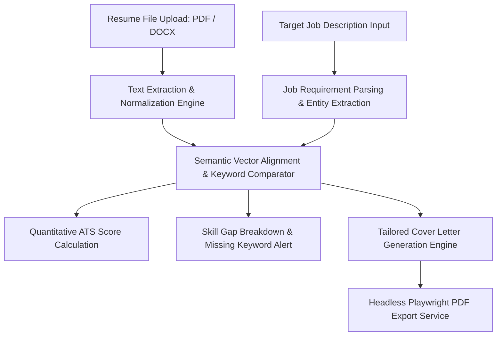

<div align="center">

<h1>Job Analyzer & ATS Resume Optimization Suite</h1>


<p><strong>Applicant Tracking System (ATS) Analysis Engine and Document Generation Platform</strong></p>

<p>
  <a href="https://skillicons.dev"></a>
</p>

</div>

---

## Executive Summary

Job Analyzer is a full-stack recruitment intelligence platform designed to parse candidate resumes, extract key technical competencies, compare qualification profiles against job descriptions, and generate quantitative ATS match scores. The platform includes an automated cover letter synthesis module and multi-template PDF compilation engine.

---

## Application Interface & Visual Analytics Gallery

<table align="center">
  <tr>
    <td align="center"><b>Candidate Dashboard & Document Manager</b><br><sub>Centralized management of resumes, candidate profiles, and target roles.</sub></td>
    <td align="center"><b>ATS Keyword Extraction & Match Analytics</b><br><sub>Quantitative matching evaluation highlighting qualification alignment.</sub></td>
  </tr>
  <tr>
    <td align="center"></td>
    <td align="center"></td>
  </tr>
  <tr>
    <td align="center"><b>Targeted Cover Letter Generation Studio</b><br><sub>Automated composition emphasizing relevant professional experience.</sub></td>
    <td align="center"><b>Skill Gap Breakdown & Recommendations</b><br><sub>Detailed skill audit isolating missing technical competencies.</sub></td>
  </tr>
  <tr>
    <td align="center"></td>
    <td align="center"></td>
  </tr>
</table>

---

## System Architecture



---

## Core Engineering Features

- **Document Parsing Engine**: Multi-format document parser extracting structured text, work history, and educational credentials from unstructured PDF and DOCX files.
- **ATS Match Scoring Algorithm**: Evaluates candidate skill sets against job posting requirements using weighted keyword frequency, semantic context, and technical relevance.
- **Automated Document Synthesis**: Formulates tailored, professional cover letters aligned to target role requirements.
- **Headless PDF Compilation**: Playwright-driven PDF rendering service generating formatted, ATS-compliant documents.

---

## Repository Structure

```
job-analyzer/
|-- client/
|   |-- src/
|   +-- package.json
|-- server/
|   |-- prisma/
|   |-- src/
|   |   |-- modules/
|   |   |   |-- candidate/
|   |   |   |-- documents/
|   |   |   |-- generation/
|   |   |   +-- jobs/
|   |   +-- server.js
|   +-- package.json
|-- SCREENSHOTS/
|   |-- 1.png
|   |-- 4.png
|   |-- 6.png
|   +-- 10.png
|-- package.json
+-- README.md
```

---

## Technology Stack

| Layer | Technologies |
| :--- | :--- |
| Frontend | React 18, Vite, Tailwind CSS, Lucide Icons |
| Backend Server | Node.js, Express, RESTful APIs |
| Database & ORM | SQLite, Prisma ORM |
| Document Rendering | Playwright Headless Browser Service |
| AI Integration | LLM API Clients for Text Processing |

---

## Installation & Setup

```bash
# Clone the repository
git clone https://github.com/sohailahmed-bsrh/job-analyzer.git
cd job-analyzer

# Install root, client, and server dependencies
npm run install:all

# Run database migrations
npm run prisma:migrate

# Start application
npm run dev
```

---

## Author & License

- **Author**: Sohail Ahmed ([Portfolio](https://sohail.devsil.com) | [GitHub](https://github.com/sohailahmed-bsrh))
- **License**: Distributed under the MIT License.
