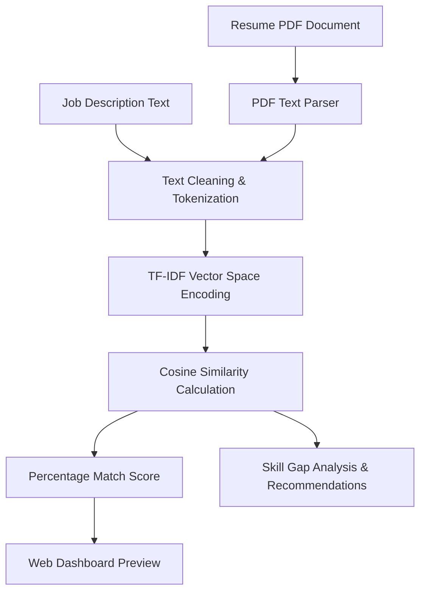

# Job Requisition Analyzer and Resume Screening Engine

> Natural language processing system that evaluates candidate resumes against technical job descriptions.

[](https://github.com/sohailahmed-bsrh/job-analyzer)
[](https://sohail.devsil.com/projects.html)
[](https://sohail.devsil.com)

---

## Overview

Recruiters and technical job applicants struggle to objectively quantify qualification alignment across unstructured text resumes and complex job specifications.

This project provides an end-to-end, reproducible implementation engineered to solve this challenge through verified data transformations, robust algorithms, and production-ready architecture.

---

## Key Features

- Text extraction from multi-page PDF documents using PyPDF2
- Named entity and keyword extraction identifying required skills, toolchains, and qualifications
- Cosine similarity calculation across TF-IDF representations to compute match percentages
- Interactive full-stack interface with candidate workspace management

---

## System Architecture



---

## Technology Stack

| Technology | Version / Spec | Role in Architecture |
| :--- | :--- | :--- |
| **Python** | `3.10+` | NLP tokenization, feature extraction, and vector calculations |
| **Scikit-learn** | `1.3+` | TF-IDF vectorizer and cosine similarity matrix |
| **React** | `18.2+` | Modular workspace UI with route protection and editor |
| **Streamlit** | `1.28+` | Standalone analytical demonstration tool |

---

## Repository Structure

```text
job-analyzer/
|-- Resume-Cover-Letter-Maker/
|   |-- frontend/
|   |   |-- src/
|   |   `-- package.json
|-- src/
|-- .gitignore
|-- requirements.txt
`-- README.md
```

---

## Installation and Execution

### Prerequisites
- Python 3.10 or higher
- Git version control
- Virtual environment manager (`venv`)

### Setup Instructions
1. Clone the repository:
```bash
git clone https://github.com/sohailahmed-bsrh/job-analyzer.git
cd job-analyzer
```

2. Configure environment and dependencies:
```bash
python -m venv venv
source venv/bin/activate  # On Windows: venv\Scripts\activate
pip install -r requirements.txt
```

---

## Interface and Verification
The system produces verifiable execution logs, prediction matrices, or interactive browser interfaces depending on the target mode. Verify operation by executing the commands specified above or inspecting the demonstration notebooks.

---

## Author and Contact
Developed by **Sohail Ahmed** — Full Stack AI Engineer & Machine Learning Specialist.
- **Portfolio:** [sohail.devsil.com](https://sohail.devsil.com)
- **GitHub:** [@sohailahmed-bsrh](https://github.com/sohailahmed-bsrh)
- **Email:** [sohail.bsrh@gmail.com](mailto:sohail.bsrh@gmail.com)
