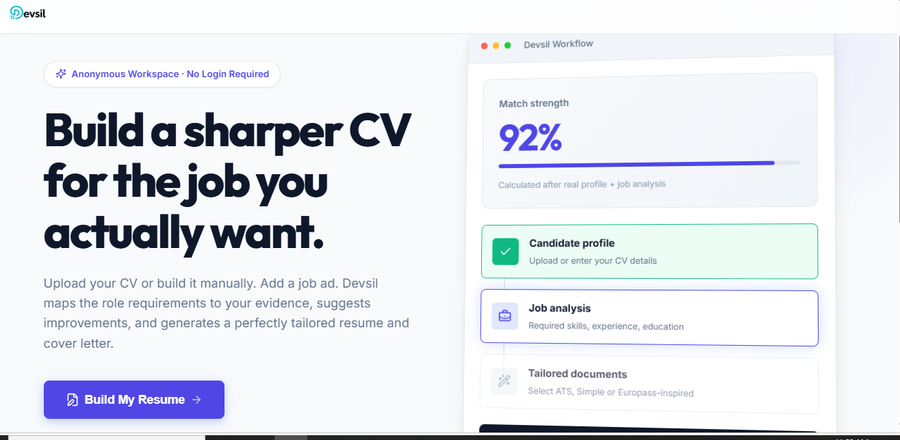
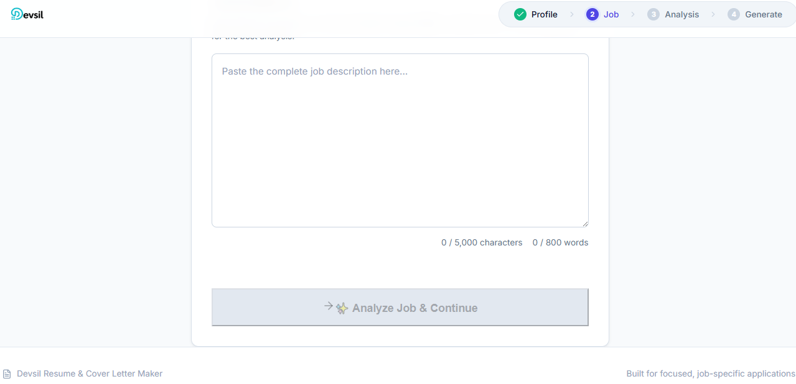
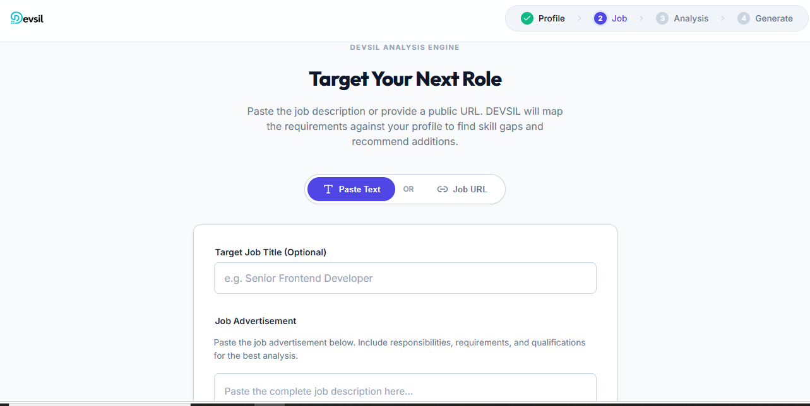
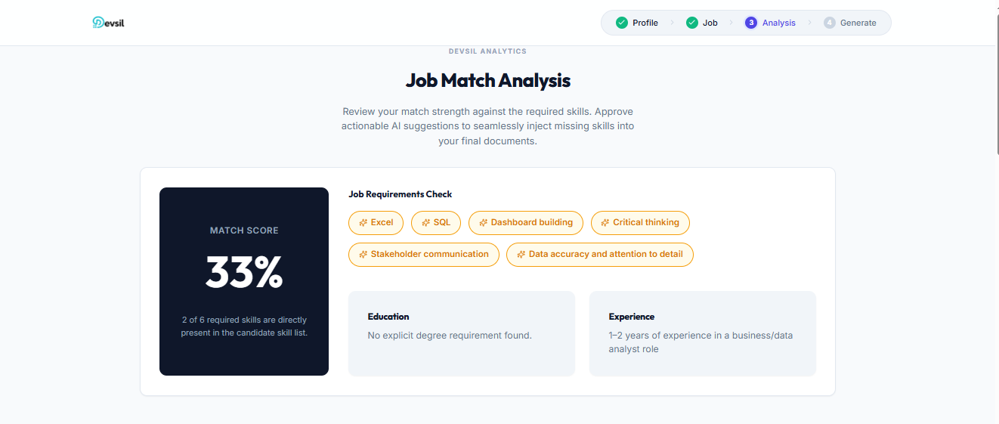
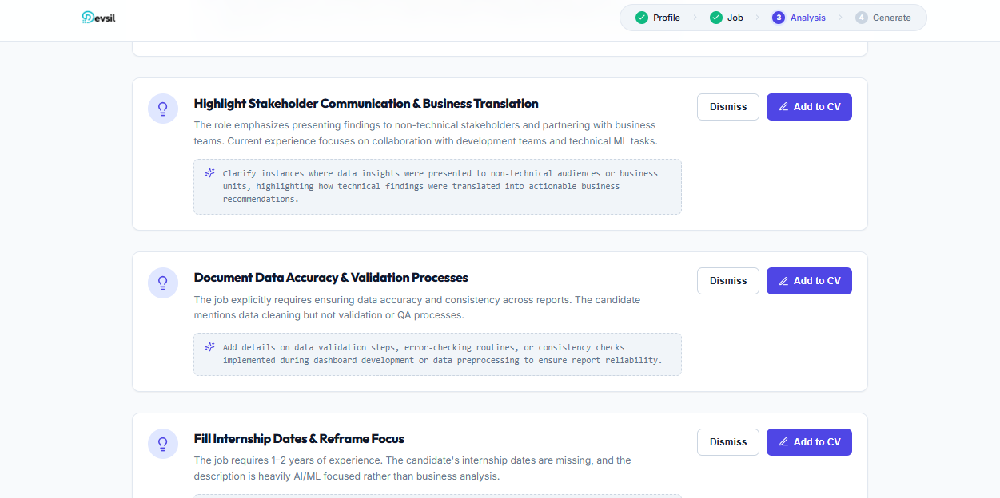
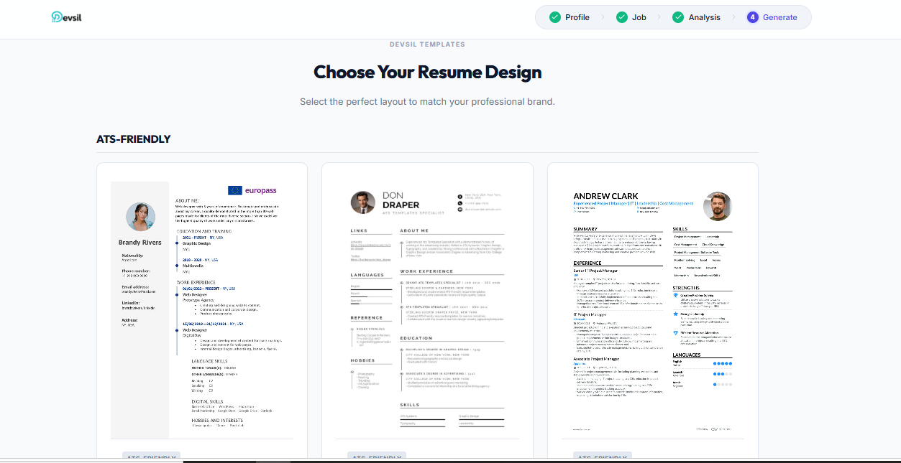
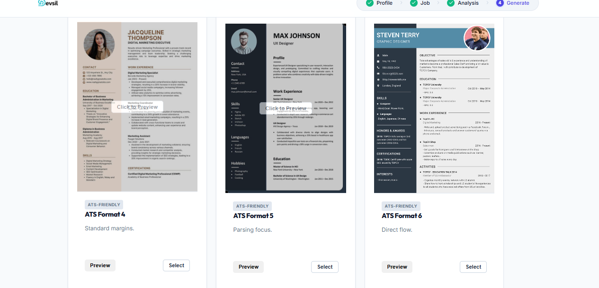
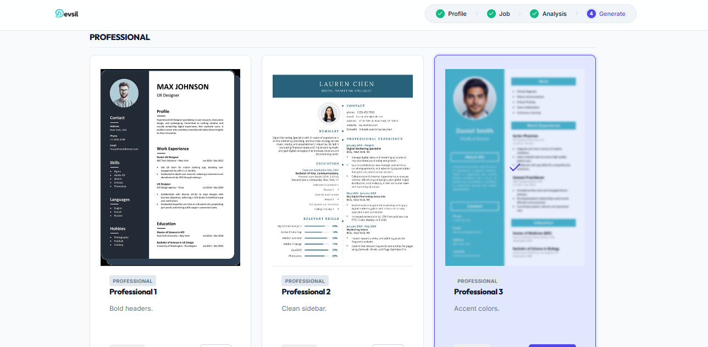
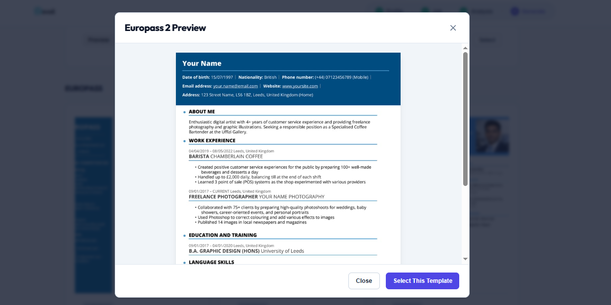

<div align="center">
  
  <h1>DEVSIL Resume & Cover Letter Maker</h1>
  <p><em>An AI-driven, multi-model document generation engine that aligns candidate experience with precise job requirements.</em></p>
  
  <p>
    
    
    
    
    
  </p>
</div>

---

## 📌 Project Overview

The **DEVSIL Resume & Cover Letter Maker** is an end-to-end web application engineered to bridge the gap between candidate backgrounds and targeted job descriptions. Unlike standard resume builders, this system actively analyzes job requirements using state-of-the-art Large Language Models (LLMs) and structures candidate evidence to maximize ATS (Applicant Tracking System) alignment.

Built with a modular architecture, the system leverages a **multi-model orchestration strategy**:
- **Groq (Qwen)** handles deep, high-speed analytical parsing of complex job descriptions.
- **Groq (GPT-OSS-120B)** dynamically constructs strictly typed, Zod-validated JSON representations of the candidate's resume.
- **Google Gemini** powers nuanced, highly contextual cover letter generation.

The final payloads are injected into React-rendered HTML templates and headless-printed directly to flawless A4 PDFs via Playwright.

---

## 🚀 Key Features

- **Automated CV Extraction:** Upload an existing DOCX or PDF resume to automatically parse and populate a candidate's structured profile.
- **Intelligent Job Analysis:** Paste a job description to instantly extract required skills, preferred qualifications, and core responsibilities.
- **Evidence-Based Matching:** The AI cross-references candidate skills against job requirements, generating a quantifiable match score and highlighting missing gaps.
- **Targeted Suggestions:** Recommends specific phrasing modifications to better align candidate experience with the employer's domain vocabulary.
- **Multi-Model Generation Engine:** Hard-routed generation pipelines to ensure the best model handles the most appropriate task, strictly bounded by Zod schemas to eliminate parsing failures.
- **Dynamic Template Rendering:** Multiple layout templates (ATS-friendly, Professional, Europass) rendered perfectly to A4 PDF specifications.

---

## 🏗 System Architecture

The application isolates concerns across a scalable stack:

1. **Client Layer (React/Vite):** Manages local state, uploads, and template previews using isolated `iframe` injection for 100% accurate PDF mapping.
2. **API & Orchestration (Express):** Receives structured data and commands the AI service. Implements robust retry-and-fallback mechanics for quota limits.
3. **Data Persistence (Prisma/SQLite):** Manages candidate profiles, extracted job analyses, and generated document payloads.
4. **AI Generation Pipeline (Groq/Gemini + Zod):** Converts unstructured context into rigorously validated JSON models, ensuring the renderer never receives malformed structures.
5. **Headless PDF Export (Playwright):** Intercepts the generated HTML payloads and prints them in a controlled Chromium environment to guarantee pixel-perfect PDF geometry.

---

## 📸 Visual Walkthrough

### 1. Landing & Candidate Profile Setup
The application provides a clean interface to upload an existing CV or build a structured profile manually.



### 2. Job Description Analysis
Paste the target job description. The AI engine parses out the raw text into distinct requirements, responsibilities, and ATS keywords.




### 3. Match Results & Intelligent Suggestions
The system computes a match score, identifies gaps, and proposes direct evidence mappings to strengthen the application.




### 4. Template Selection
Choose from a curated registry of templates ranging from modern ATS-optimized designs to Europass standards.



### 5. Final PDF Generation & Preview
The AI synthesizes the tailored document. The result is injected into an embedded preview mirroring exact A4 print dimensions before headless PDF export.





*(Additional UI views cover dashboard navigation, document history, and exporting tools—refer to the `/SCREENSHOTS` directory for the full workflow.)*

---

## 🛠 Tech Stack

| Category | Technologies |
|---|---|
| **Frontend** | React 19, Vite, React Router, CSS, Lucide React |
| **Backend** | Node.js, Express.js, Multer |
| **AI Integration** | Groq SDK, Google GenAI SDK, Zod (Structured Output) |
| **Database** | SQLite, Prisma ORM |
| **Document Processing**| `pdf-parse`, `mammoth` (DOCX) |
| **Export Engine** | Playwright (Chromium Headless Printing) |

---

## 📂 Project Structure

```text
project/
├── frontend/                 # React SPA (Vite)
│   ├── src/
│   │   ├── components/       # Reusable UI components
│   │   ├── pages/            # View-controllers (Candidate, Job Analysis, Generate)
│   │   └── services/         # API boundary integration
├── server/                   # Node.js / Express backend
│   ├── prisma/               # Database schemas and migrations
│   ├── src/
│   │   ├── api/              # Route controllers and middleware
│   │   ├── infrastructure/   # AI providers, Database, PDF, and Storage engines
│   │   └── modules/          # Domain logic (Candidate, Job, Generation, Documents)
├── SCREENSHOTS/              # Documentation assets
└── README.md
```

---

## ⚙️ Installation & Setup

### Prerequisites
- **Node.js** (v18+)
- API Keys for **Groq** and **Google Gemini**

### 1. Clone the Repository
```bash
git clone https://github.com/sohail-ahmed-26/Resume-Cover-Letter-Maker.git
cd Resume-Cover-Letter-Maker
```

### 2. Setup the Backend
```bash
cd server
npm install
```
Create a `.env` file in the `server` directory (reference the provided `.env.example` if available, or use the structure below):
```env
PORT=5186
WEB_ORIGIN=http://localhost:5185
DATABASE_URL="file:./dev.db"

# AI Provider Keys
GEMINI_API_KEY=your_gemini_key
GEMINI_MODEL=gemini-3.6-flash

GROQ_API_KEY=your_groq_key
GROQ_MODEL=qwen/qwen3.6-27b

GROQ_CV_API_KEY=your_groq_cv_key
GROQ_CV_MODEL=openai/gpt-oss-120b

# Security
JWT_ACCESS_SECRET=your_jwt_secret
MAX_UPLOAD_MB=8
UPLOAD_DIR=./storage/uploads
```
Initialize the database:
```bash
npm run db:generate
npm run db:migrate
```

### 3. Setup the Frontend
```bash
cd ../frontend
npm install
```

---

## 🖥 Running the Application

Start the backend (from the `server` directory):
```bash
npm run dev
```

Start the frontend (from the `frontend` directory):
```bash
npm run dev
```

Open `http://localhost:5185` in your browser.

---

## 💡 Engineering Highlights

- **Multi-Model Orchestration:** The system explicitly bounds specific LLM models to distinct tasks (e.g., highly logical models for job parsing, high-context models for JSON structuring) to optimize cost, speed, and accuracy.
- **RAG-Inspired Synthesis:** Instead of blindly generating text, the application enforces the AI to pull *only* from the extracted facts provided in the Candidate Profile, severely reducing hallucination.
- **Strict Schema Enforcement:** By chaining AI output through `Zod`, the system guarantees that the rendering engine never receives structurally malformed JSON, preventing fatal application crashes.
- **Headless PDF Geometry:** By utilizing `Playwright` instead of standard CSS-to-PDF libraries, the application achieves perfect flexbox, CSS Grid, and custom-font rendering mirroring the exact browser DOM.

---

## 🔮 Future Improvements

- **Authentication & Multi-Tenant Support:** Implement fully isolated workspaces for multiple users.
- **Dockerization:** Containerize the React and Node.js instances for immediate cloud deployment.
- **Expanded Template Engine:** Introduce custom CSS overrides allowing users to fine-tune margin geometries and typography via a visual editor.
- **Vector Database Integration:** Introduce a Pinecone/Chroma layer to historically track which skill keywords result in the highest interview yield over time.

---

## 👨‍💻 Author

**Sohail Ahmed**  
*AI Engineer | Data Scientist*

Focused on building scalable AI systems, LLM applications, RAG architectures, and data-driven web products. 

- **Portfolio:** [https://sohail.devsil.com/](https://sohail.devsil.com/)
- **GitHub:** [sohail-ahmed-26](https://github.com/sohail-ahmed-26)
- **LinkedIn:** [sohail-ahmed-devsil](https://www.linkedin.com/in/sohail-ahmed-devsil)

---

<div align="center">
  <p><em>Built for precision. Engineered for impact.</em></p>
</div>
